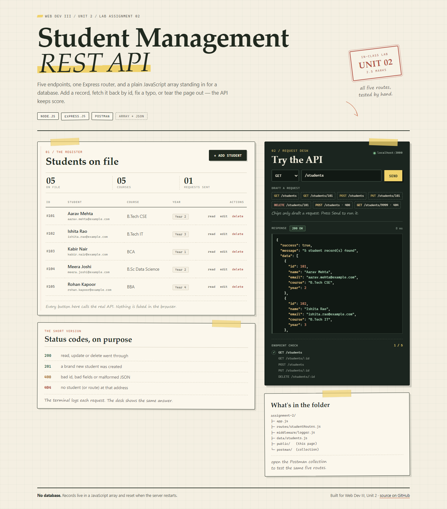
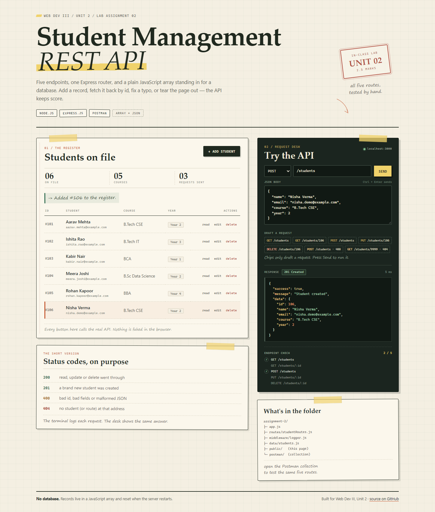
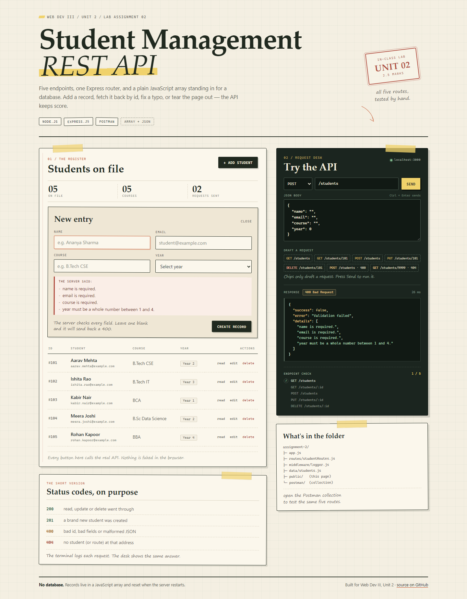
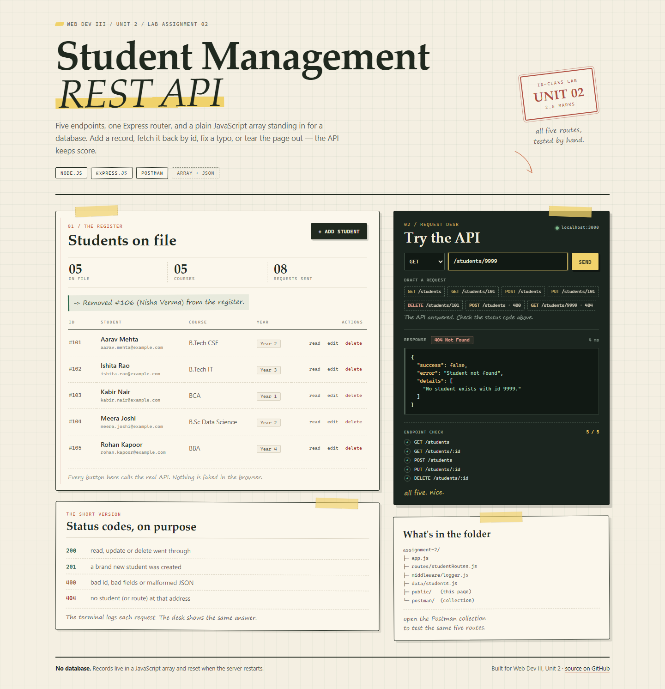
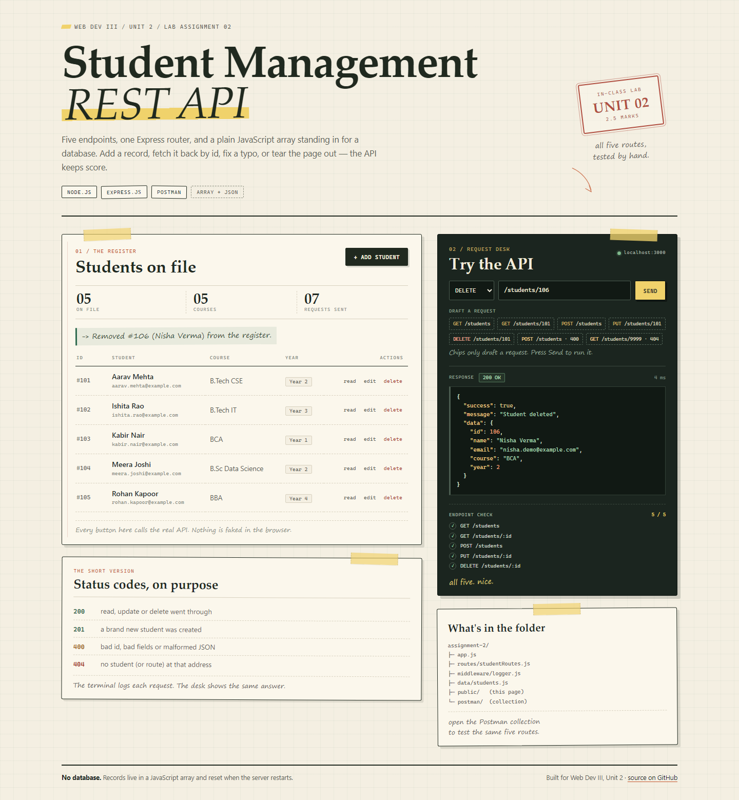

# Student Management REST API

**Web Dev III / Unit 2 / Lab Assignment 2**<br>
Node.js + Express.js + Postman · in-class lab · 2.5 marks

A small Express server that keeps a class register in memory and exposes it over five REST endpoints. No database, no Mongoose, no extra libraries — just an array, a router, a custom logger, and proper status codes.



---

## Assignment checklist

| Requirement | Where it is implemented |
| --- | --- |
| Create an Express server | `app.js` |
| Student CRUD APIs | `routes/studentRoutes.js` |
| Custom logger middleware | `middleware/logger.js` |
| Modular routing | `app.js` mounts `/students`, routes live in their own file |
| Proper error handling | `200`, `201`, `400`, `404`, plus a `500` safety net |
| Array and JSON data only | `data/students.js` |
| Test the APIs in Postman | `postman/Student_Management_API.postman_collection.json` |
| Required project structure | `routes/`, `middleware/`, `data/`, `app.js` |

**Restrictions respected:** no MongoDB, no MySQL, no Mongoose. Records are a plain JavaScript array and reset when the server restarts. Express is the only dependency.

---

## Project structure

```text
assignment-2/
├─ app.js                  # server, middleware order, 404 + error handler
├─ routes/
│  └─ studentRoutes.js     # all five student endpoints
├─ middleware/
│  └─ logger.js            # custom request logger
├─ data/
│  └─ students.js          # five seed records (in-memory array)
├─ public/                 # optional demo client, no framework
│  ├─ index.html
│  ├─ styles.css
│  └─ ui.js
├─ postman/
│  └─ Student_Management_API.postman_collection.json
├─ docs/
│  └─ screenshots/
├─ package.json
└─ README.md
```

The four files required by the assignment are present with the exact names: `app.js`, `studentRoutes.js`, `logger.js`, `students.js`.

---

## Run it

```bash
cd assignment-2
npm install
npm start
```

Server: [http://localhost:3000](http://localhost:3000)<br>
Demo page: [http://localhost:3000](http://localhost:3000)
`npm run dev` uses Node's built-in `--watch` flag, so no nodemon dependency is needed.

To reset the register, stop and restart the server. The five seed students come back.

---

## API reference

Base URL: `http://localhost:3000`

| Method | Endpoint | What it does | Success | Failure |
| --- | --- | --- | --- | --- |
| `GET` | `/students` | List every student | `200 OK` | — |
| `GET` | `/students/:id` | Read one student by id | `200 OK` | `400` invalid id, `404` not found |
| `POST` | `/students` | Create a student | `201 Created` | `400` validation |
| `PUT` | `/students/:id` | Replace a student's details | `200 OK` | `400` invalid id/body, `404` not found |
| `DELETE` | `/students/:id` | Remove a student | `200 OK` | `400` invalid id, `404` not found |

### Student object

```json
{
  "id": 101,
  "name": "Aarav Mehta",
  "email": "aarav.mehta@example.com",
  "course": "B.Tech CSE",
  "year": 2
}
```

`POST` and `PUT` require `name`, `email`, `course` and `year`. The `id` is assigned by the server. The four fields are validated:

- `name` and `course` cannot be empty or shorter than 2 characters.
- `email` must look like an email and cannot duplicate another student's email.
- `year` must be a whole number from 1 to 4.

### Response shape

Success:

```json
{
  "success": true,
  "message": "Student created",
  "data": { "id": 106, "name": "Nisha Verma", "email": "nisha@example.com", "course": "B.Tech CSE", "year": 2 }
}
```

Failure:

```json
{
  "success": false,
  "error": "Validation failed",
  "details": ["name is required.", "year must be a whole number between 1 and 4."]
}
```

---

## Examples

### GET /students → 200

```json
{
  "success": true,
  "message": "5 student record(s) found",
  "data": [
    { "id": 101, "name": "Aarav Mehta", "email": "aarav.mehta@example.com", "course": "B.Tech CSE", "year": 2 }
  ]
}
```

### POST /students → 201

```http
POST /students
Content-Type: application/json
```

```json
{
  "name": "Nisha Verma",
  "email": "nisha.verma@example.com",
  "course": "B.Tech CSE",
  "year": 2
}
```

```json
{
  "success": true,
  "message": "Student created",
  "data": {
    "id": 106,
    "name": "Nisha Verma",
    "email": "nisha.verma@example.com",
    "course": "B.Tech CSE",
    "year": 2
  }
}
```

The response also sets `Location: /students/106`.

### POST /students → 400

```json
{
  "success": false,
  "error": "Validation failed",
  "details": [
    "name is required.",
    "email must be a valid email address.",
    "course is required.",
    "year must be a whole number between 1 and 4."
  ]
}
```

### PUT /students/106 → 200

```json
{
  "success": true,
  "message": "Student updated",
  "data": {
    "id": 106,
    "name": "Nisha Verma",
    "email": "nisha.verma@example.com",
    "course": "BCA",
    "year": 3
  }
}
```

### DELETE /students/106 → 200

```json
{
  "success": true,
  "message": "Student deleted",
  "data": { "id": 106, "name": "Nisha Verma", "email": "nisha.verma@example.com", "course": "BCA", "year": 3 }
}
```

### GET /students/9999 → 404

```json
{
  "success": false,
  "error": "Student not found",
  "details": ["No student exists with id 9999."]
}
```

### GET /students/abc → 400

```json
{
  "success": false,
  "error": "Invalid student id",
  "details": ["Student id must be a positive integer."]
}
```

Malformed JSON is caught by the central error handler and returned as a `400 Invalid JSON body` instead of crashing the server. Unknown routes return `404 Route not found`.

---

## Middleware order

```js
app.use(express.static(path.join(__dirname, "public"))); // demo page, not logged
app.use(logger);                                        // custom logger
app.use(express.json());                                // JSON body parser
app.use("/students", studentRoutes);                    // modular router
app.use((req, res) => { /* 404 */ });                   // unmatched routes
app.use((err, req, res, next) => { /* 400 for bad JSON, 500 fallback */ });
```

The logger prints the method, path, final status, duration, and the body of `POST`/`PUT` requests. Real output from this build:

```text
  STUDENT MANAGEMENT REST API
  Web Dev III - Unit 2 - Lab Assignment 2
  http://localhost:3000
  5 seed records in memory - no database

21:28:12  POST   /students                    400    49.1 ms
          body {"name":"","email":"","course":"","year":0}
21:28:13  POST   /students                    201     2.0 ms
          body {"name":"Nisha Verma","email":"nisha.demo@example.com","course":"B.Tech CSE","year":2}
21:28:14  GET    /students/102                200     2.3 ms
21:28:15  PUT    /students/106                200     0.8 ms
21:28:17  DELETE /students/106                200     0.7 ms
21:28:18  GET    /students/9999               404     0.9 ms
```

---

## Testing in Postman

1. Start the server with `npm start`.
2. In Postman: **Import** → choose `postman/Student_Management_API.postman_collection.json`.
3. Open **CRUD - run in order** and send the requests from top to bottom. The create request saves the new id in a collection variable, so read, update and delete all use the same record.
4. Run **Error handling** to see the `400` and `404` responses.

The collection contains 11 requests with basic test assertions. The `baseUrl` collection variable is already set to `http://localhost:3000`.

| Folder | Requests | Expected |
| --- | --- | --- |
| CRUD - run in order | get all, get one, create, get created, update, delete | `200`, `200`, `201`, `200`, `200`, `200` |
| Error handling | invalid id, missing fields, malformed JSON, missing student, unknown route | `400`, `400`, `400`, `404`, `404` |



---

## The demo page

The page at `/` is a thin vanilla HTML/CSS/JS client over the same five endpoints. It is not a replacement for Postman and it does not mock any data — every button issues a real request, and the request desk shows the actual status code and JSON response.

It was built to make the in-class demo easy to read:

- The register shows the current array.
- Add / edit / delete go through `POST`, `PUT`, `DELETE`.
- Clicking a row calls `GET /students/:id`.
- The request desk can send any of the five routes, plus deliberate `400` and `404` cases.
- The endpoint checklist ticks each route after its first successful call.







The interface uses only system fonts and plain CSS. No React, no Tailwind, no icon library. It collapses to a single column on a phone; course and year move under the student's name so the row actions stay reachable. A 390 px capture is in [ui-mobile.png](docs/screenshots/ui-mobile.png).

---

## Verification

Checked by hand with `curl` and through the page:

| Check | Result |
| --- | --- |
| `GET /students` | `200`, returns 5 records |
| `GET /students/101` | `200` |
| `GET /students/abc` | `400 Invalid student id` |
| `GET /students/9999` | `404 Student not found` |
| `POST /students` valid body | `201`, new id assigned |
| `POST /students` empty body | `400`, field details |
| `PUT /students/106` valid body | `200`, same id, updated fields |
| `PUT /students/9999` | `404` |
| `DELETE /students/106` | `200`, record returned |
| `DELETE /students/106` again | `404` |
| Malformed JSON body | `400 Invalid JSON body` |
| Unknown route | `404 Route not found` |

---

## Notes

- Data is intentionally in memory. This follows the assignment restriction and means the five seed students return after every server restart.
- The `public/` folder and the Postman collection are additions around the required server; the required Express API itself uses only `app.js`, `routes/`, `middleware/` and `data/`.
- No authentication, database, or persistence layer is included because none was requested.

Built by **Agrima Mishra** for Web Dev III, Unit 2.
